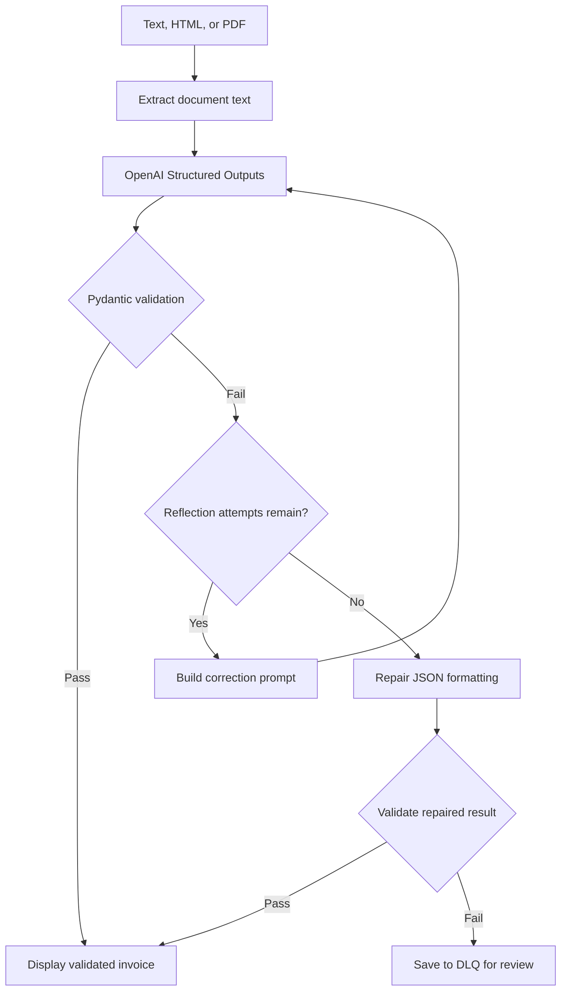

# Structured Data Extractor

**Author:** Fathiya Yoosef

An invoice extraction application built with Python, Streamlit, OpenAI
Structured Outputs, and Pydantic v2.

The application converts invoice text, HTML, or text-based PDFs into
validated invoice records. It checks calculations, requests corrections
when validation fails, and saves unresolved failures for human review.

## Features

- Paste invoice text or HTML, or upload a text-based PDF.
- Extract structured invoice information using OpenAI Structured Outputs.
- Validate required fields, dates, quantities, currencies, and monetary amounts.
- Check line-item calculations, subtotal, and grand total.
- Enable or disable reflection self-correction.
- Display source text and validated JSON side by side.
- Inspect validation errors, raw responses, and corrective prompts.
- Download validated JSON.
- Simulate reflection recovery and dead-letter queue failures.

Scanned image-only PDFs require OCR, which is not currently implemented.

## System Architecture



API errors and model refusals stop the reflection loop and route the
failure to the DLQ.

## Project Structure

```text
structured-data-extractor/
├── pyproject.toml
├── uv.lock
├── README.md
├── .gitignore
├── .python-version
└── src/
    └── structured_data_extractor/
        ├── __init__.py
        ├── schemas.py
        ├── extractor.py
        ├── fallback.py
        └── app.py
```

The `dlq/` folder is created automatically when a failure is saved.

## Requirements

- Python 3.11 or later
- uv
- An OpenAI API key for live extraction

The built-in simulations do not require an API key.

## Installation

After cloning or downloading the repository, open a terminal in the
project folder:

```bash
cd structured-data-extractor
uv python pin 3.11
uv sync
```

## API Key Configuration

Create a file named `.env` in the project root, beside `pyproject.toml`:

```dotenv
OPENAI_API_KEY=your_api_key_here
OPENAI_MODEL=gpt-4o-mini
```

Add the following entries to `.gitignore`:

```gitignore
.env
.venv/
__pycache__/
.pytest_cache/
dlq/
```

Keep the real API key out of GitHub. Restart the application after
changing `.env`.

## Run the Application

From the project root, run:

```bash
uv run streamlit run src/structured_data_extractor/app.py
```

Open the local URL printed in the terminal, usually:

```text
http://localhost:8501
```

## How to Use

### Live Extraction

1. Select **Live AI extraction** in the sidebar.
2. Paste invoice text or HTML, or upload a PDF.
3. Choose whether to enable reflection.
4. Set the maximum total attempts.
5. Click **Extract invoice**.
6. Review the validated JSON, reconciliation message, and audit details.

### Simulated Reflection Recovery

1. Select **Simulated reflection recovery**.
2. Enable reflection and allow at least two attempts.
3. Click **Extract invoice**.

The simulation supplies an incorrect total on attempt 1 and a correct
fixed response on attempt 2. It tests the validation and retry workflow
without making an AI request.

### Simulated Hard Failure

Click **Simulate Edge Case Failure**.

The application supplies invalid fixed responses. After the configured
attempt limit and unsuccessful JSON repair, it saves a failure record
under `dlq/`.

Simulations verify application behavior; they do not demonstrate live
AI extraction or live AI correction.

## Schema Specification

### LineItem

| Field | Type | Validation |
|---|---|---|
| description | string | Must not be empty |
| quantity | integer | Strict integer greater than zero |
| unit_price | Decimal | Greater than zero |
| line_total | Decimal | Zero or greater |

Each line total must match `quantity × unit_price` within 0.02.

### InvoiceExtraction

| Field | Type | Validation |
|---|---|---|
| invoice_number | string | Required; permitted identifier pattern |
| vendor_name | string | Must not be empty |
| invoice_date | date | Supported date formats are normalized |
| line_items | list of LineItem | At least one item |
| subtotal | Decimal | Zero or greater |
| tax_amount | Decimal | Zero or greater |
| total_amount | Decimal | Zero or greater |
| currency | enum | USD, EUR, or GBP |

Money uses Decimal arithmetic and allows up to two decimal places.
Supported currency symbols and comma separators are removed before
validation.

Cross-field checks enforce:

- Sum of line totals matches subtotal within 0.02.
- Sum of line totals plus tax matches total amount within 0.02.

Unexpected fields are rejected.

## Reflection and Fallback Strategy

1. Request a schema-constrained response.
2. Validate the response using Pydantic v2.
3. On validation failure, prepare a correction prompt containing a
   bounded source excerpt, previous output, and exact validation errors.
4. Retry with bounded exponential backoff.
5. If validation still fails, attempt JSON formatting repair.
6. Validate the repaired result against the same schema.
7. Save unresolved failures to the DLQ.

The maximum attempt setting includes the first attempt. Disabling
reflection allows one model attempt, followed by heuristic repair
and DLQ handling if needed.

The application never intentionally changes source amounts merely to
force reconciliation.

## Result Statuses

| Status | Meaning |
|---|---|
| SUCCESS | The first response passed validation |
| REPAIRED_VIA_REFLECTION | A later response passed validation |
| REPAIRED_VIA_HEURISTIC | JSON formatting repair produced a valid record |
| DLQ_FAILED | Extraction failed and requires human review |

A DLQ record contains the source text, last payload, errors, attempt
count, and timestamp. If saving fails, the interface reports that failure.

## Automated Testing

The automated test suite is the next implementation step.

Once the test files are added, run:

```bash
uv run pytest -v
```

Required coverage includes:

- Golden document extraction on attempt 1.
- Invalid quantity and negative amount rejection.
- Cross-field reconciliation failure.
- Reflection recovery on attempt 2.
- DLQ routing after repeated failures.

## AI Audit Log

AI assisted with the initial implementation. A separate
`ai_prompt_log.md` must document the prompts, actual issues discovered
during review, corrections, and verification results.

Areas to audit include:

- Pydantic v2 syntax.
- Prompt size and evidence selection during retries.
- Validation after heuristic repair.
- Date and monetary parsing.
- Differences between simulated and live behavior.

## Current Limitations

- Live AI extraction still needs to be verified with an API key.
- Reflection prompts currently use the first 6,000 source characters;
  relevant evidence later in a document may be omitted.
- Documents over 24,000 text characters are rejected.
- Passing schema and arithmetic checks does not prove every extracted
  fact matches the source.
- Automated tests, sample files, the audit log, and deployment packaging
  remain to be completed.